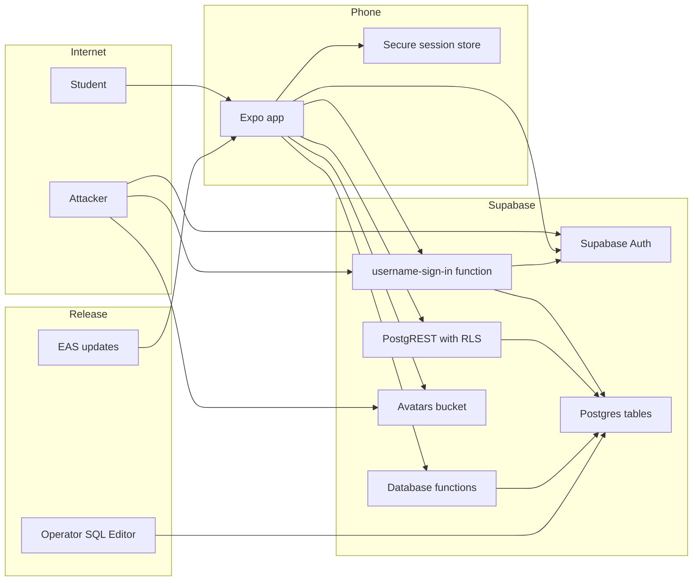

# CarpoolBoard (Prototype 11) — Threat Model

_Date: 2026-11-18 · Repo: `Prototype 11` (commit `f628851`) · Method: `.claude/skills/security-threat-model` (repo-grounded threat model)_

**How to read this report.** Each finding is labelled with how we know it:

- **[Code]**: confirmed by reading the source code or SQL scripts in this repo.
- **[Live-verified]**: confirmed against the live Supabase project by a read-only query the owner ran on 2026-11-18.
- **[Assumption]**: depends on live settings (Supabase dashboard, EAS) that haven't been checked yet.

## Executive summary

CarpoolBoard's server-side permission design is careful. Every write takes the user's identity from their login session (`auth.uid()`), never from the app. Sensitive actions (request a seat, accept, review, message) go through database functions that re-check ownership, time and seat rules. Private messages are readable only by the two people in the conversation. Live checks on 2026-11-18 confirmed that the anonymous (signed-out) role has **no** access to the main tables and **no** unexpected functions.

The most important remaining risk is **who can get an account**. Sign-up accepts any email address, and every signed-in account can read every classmate's name, photo, car, ride destinations, pickup points, departure times and the free-text reason on every ride request (**TM-001, high**). That is a personal-safety exposure for real classmates.

The remaining risks are smaller:
- The lockdown could be undone by re-running an old setup script (**TM-002, medium**).
- Anyone on the internet can lock a user, or everyone, out of sign-in (**TM-003, medium**).
- App updates pushed over the air aren't signed (**TM-005, medium**).

Showcase demos use separate demo data, so showcase visitors aren't exposed to real classmates' information.

## Scope and assumptions

**In scope (runtime):** `App.js`, `screens/`, `components/`, `lib/`, `supabase/*.sql`, `supabase/functions/username-sign-in/index.ts`, `app.json`, `eas.json`.

**Out of scope:** `__tests__/`, `test-results/`, `design-reference/` (design export, not shipped), `dist/` (local build output, git-ignored), `node_modules/`, Supabase/Expo platform internals, a compromised phone OS.

**Context confirmed by the owner (2026-11-18):**
- Classroom prototype: internal builds, a few dozen students, over-the-air (OTA) updates through EAS org `smu-c3-mobile-fall-26`.
- Sign-up is open to **any email address**. No SMU-only restriction exists.
- Showcase demos use **demo data only**, not the classmates' live project data.
- Live lockdown checks (auth-2 queries b and c2) passed. See TM-002.

**Assumptions still open:**
- [Assumption] "Confirm email" is ON in Supabase Auth, as `supabase/AUTH-MIGRATION.md` §3 instructs.
- [Assumption] The deployed `username-sign-in` function matches the repo version.
- [Assumption] Supabase's gateway may let a caller influence the first `x-forwarded-for` value. The function's own comment assumes it can.
- [Assumption] Several classmates have publish rights in the EAS org.

**Open questions that would change rankings:**
1. Is "Confirm email" on? If off, TM-001 needs no working inbox at all.
2. How many people can publish EAS updates or administer the Supabase project? (TM-005, TM-002)
3. Will the app ever go beyond the class (store release, wider SMU)? That raises TM-001 and TM-005.

## System model

### Primary components
- **Mobile app** (Expo SDK 58, React Native 0.88). Calls Supabase directly with the public "publishable" key (`lib/supabase.js`). Stores the login session in the iOS Keychain / Android Keystore, device-only (`lib/secureSessionStorage.js`). Location is used only on the phone to suggest a pickup and is never sent (`lib/currentLocation.js`, `lib/nearestPickup.js`).
- **Supabase Auth.** Email + password accounts, with 6-digit codes for confirmation and password reset (`lib/auth.js`).
- **Edge Function `username-sign-in`.** Callable without login (`--no-verify-jwt`). Holds the all-powerful service-role key. Looks up the private email for a username, checks the password with Supabase Auth, and returns session tokens. Throttles guessing through `sign_in_attempts` (`supabase/functions/username-sign-in/index.ts`).
- **Postgres via PostgREST.** `profiles`, `rides`, `ride_requests`, `driver_reviews`, `ride_conversations`, `ride_messages`, `sign_in_attempts`, and the `driver_rating_summary` view. Protected by Row Level Security (RLS) and grants (`supabase/auth-2-lockdown.sql`, `supabase/messaging-1-tables.sql`).
- **Database functions (RPCs).** `submit_my_ride_request`, `accept_my_ride_request`, `submit_my_driver_review`, `open_my_ride_conversation`, `send_my_ride_message` (SECURITY DEFINER, `search_path = ''`). `list_my_ride_conversations` (SECURITY INVOKER). `is_username_available` is callable signed-out.
- **Storage bucket `avatars`.** Public to view. Signed-in users may upload only into their own folder, JPEG/PNG only, 2 MB max (`supabase/avatar-storage.sql:58`, `supabase/auth-2-lockdown.sql:279-285`).
- **EAS Build / Updates.** OTA JavaScript updates from `u.expo.dev`, owner `smu-c3-mobile-fall-26` (`app.json` `updates`, `owner`). No update code signing is configured.
- **Operator tooling.** SQL scripts pasted by hand into the Supabase SQL Editor (`supabase/AUTH-MIGRATION.md`).

### Data flows and trust boundaries
- **Internet → Supabase Auth** (HTTPS, publishable key).
  - Carries email, password, 6-digit codes and session tokens.
  - Guarantees: email confirmation [Assumption], Supabase rate limits, and the same answer whether or not an email exists (`lib/auth.js` `signUpWithUsername`, `requestPasswordReset`).
  - Gap: no email-domain allow-list [Code].
- **Internet → `username-sign-in`** (HTTPS POST, no login).
  - Carries username, password and returned tokens.
  - Validation: username pattern, password ≤ 72 characters.
  - Throttle per 15 minutes: 5 failures per (client, username), 20 per username, 50 per client. The "client" is an HMAC of the first `x-forwarded-for` value.
  - Guarantees: the same 401/429 responses in all cases.
- **Edge Function → Postgres / Auth admin** (service role). Maps username → user id → email. Bypasses RLS; safety rests on the function's code.
- **Edge Function → Supabase Auth `signInWithPassword`.** Every user's sign-in arrives from Supabase's own servers, so they all share Auth's per-IP limit.
- **App (signed in) → PostgREST tables.**
  - Guarantees: RLS keyed on `auth.uid()`. Column grants hide `profiles.email` and allow only `status` changes on `ride_requests`.
  - Validation: database CHECK constraints on text lengths and coordinates.
- **App → database functions.** Identity comes from `auth.uid()`. Ownership, state and time checks; duplicate-safe inserts; a limit of 20 messages per minute.
- **App → `avatars` upload.** The server enforces a path pattern of `<own user id>/<13 digits>.jpg|jpeg|png`, the MIME type and the size.
- **Anyone → avatar URLs.** Public; no login.
- **EAS → installed apps.** OTA JavaScript bundle. Trust rests on EAS account security alone; there's no signature check on the device.
- **Operator → SQL Editor.** Manual migrations. Running an old script again can re-open access (TM-002).

#### Diagram


## Assets and security objectives

| Asset | Why it matters | Security objective (C/I/A) |
|---|---|---|
| Ride schedules: destination, pickup landmark/coordinates, departure time, driver (`rides`) | Shows where and when a named student will be. Physical-safety relevant | C, I |
| Ride request reasons (`ride_requests.reason`) | Free text students write to a driver, readable by every signed-in user | C |
| Profiles: name, username, photo, bio, vehicle (`profiles`, `avatars`) | Links a real person and their car to the schedule | C, I |
| Email addresses (`auth.users`; legacy `profiles.email`) | Personal information and the password-reset channel | C |
| Session tokens (Keychain/Keystore, Edge Function responses) | Whoever holds them is that user | C |
| Passwords (in transit; bcrypt hash in Auth) | Account takeover; reuse on other sites | C |
| Private messages (`ride_messages`) | Private driver–rider conversation | C, I |
| Reviews and ratings (`driver_reviews`) | Driver reputation and trust | I |
| Service-role key (Edge Function only) | Bypasses all database protections | C |
| EAS update channel and accounts | Can run new code inside every installed app | I |
| Sign-in availability | Students can't get into the app | A |

## Attacker model

### Capabilities
- Anyone on the internet can create an account with any email they control and become a signed-in user [Code; confirmed by the owner].
- Anyone can pull the publishable key and project URL out of the app (they're built in by design) and call Supabase directly with any parameters.
- Anyone can send unlimited signed-out requests to the Edge Function and the Auth endpoints, possibly with a forged `x-forwarded-for` header.
- Once signed in, anyone can list every username and user id (all profiles are readable).
- A classmate with EAS publish rights can ship an OTA update to every installed copy.
- A classmate with Supabase admin rights can run SQL scripts, including old ones.

### Non-capabilities
- **Cannot get the service-role key from the app.** `.env.local` holds only the URL, the publishable key and a feature flag. The built bundle in `dist/` contains no secret-key value (`sb_secret_` matches are library text only) [Code].
- **Cannot act as another user on the server.** All write functions use `auth.uid()`. Signed-in users have no direct INSERT on `ride_requests`, `driver_reviews` or messages (`supabase/auth-2-lockdown.sql:155-164`, `supabase/messaging-1-tables.sql:710-713`) [Code].
- **Cannot read other people's messages or emails through the API.** Conversation RLS is participant-only. `email` is left out of the profile column grant (`supabase/auth-2-lockdown.sql:150`) [Code].
- **Signed-out users cannot read or write the main tables** [Live-verified, query b].
- **No server-side HTML rendering, URL fetching or command execution exists**, so SSRF, server XSS and remote code execution don't apply. React Native `Text` limits client-side injection.

## Entry points and attack surfaces

| Surface | How reached | Trust boundary | Notes | Evidence |
|---|---|---|---|---|
| `username-sign-in` | Signed-out HTTPS POST | Internet → Edge Function (service role) | Throttle keyed on a possibly forgeable header; shared Auth IP | `supabase/functions/username-sign-in/index.ts` `clientKeyFor`, `MAX_FAILURES_*` |
| Auth sign-up / codes / resend / reset / password change | Publishable key | Internet → Auth | Open sign-up; 6-digit codes | `lib/auth.js` `signUpWithUsername`, `verifyRecoveryCode`, `updatePassword` |
| Sign-up trigger | New Auth user | Auth → `profiles` | Username validated; role forced to `driver`/`rider` | `supabase/auth-1-accounts.sql:209-243` `handle_new_auth_user` |
| `is_username_available` | Signed out | Internet → DB | Reveals whether a username exists | `supabase/auth-1-accounts.sql:252-267` |
| Board reads | Signed in | App → PostgREST | `using (true)` on profiles, rides, requests, reviews | `supabase/auth-2-lockdown.sql:177-271` |
| Ride insert/update/delete | Signed in | App → PostgREST | Owner-only, but every column editable | `supabase/auth-2-lockdown.sql:155,205-223`; `App.js:1220-1240` |
| Request status change | Signed in | App → PostgREST | `status` only; rider-cancel / driver-deny policies | `supabase/auth-2-lockdown.sql:161,239-263` |
| Request / accept / review functions | Signed in | App → DB functions | Ownership, time and seat checks | `supabase/auth-1-accounts.sql` `submit_my_ride_request`, `accept_my_ride_request`, `submit_my_driver_review` |
| Messaging functions | Signed in | App → DB functions | Participant check, 20/min, retry-safe | `supabase/messaging-1-tables.sql` `open_my_ride_conversation`, `send_my_ride_message` |
| Avatar upload / view | Signed in / public URL | App → Storage; Internet → Storage | Own-folder uploads; public viewing | `supabase/auth-2-lockdown.sql:279-285`; `lib/avatar.js:31` |
| Retired functions trusting a caller-supplied id | Only if access is re-granted | Internet → DB | Still exist; currently not executable [Live-verified] | `supabase/prototype-6.sql:360`; `supabase/prototype-6-reviews*.sql` |
| OTA updates | EAS publish | Release → phone | No code signing | `app.json` `updates`, `owner` |
| SQL Editor | Supabase admin | Operator → DB | Manual, order-sensitive scripts | `supabase/AUTH-MIGRATION.md` |

## Top abuse paths

1. **Tracking a classmate (TM-001).**
   1. A stranger signs up with any email and confirms the code.
   2. They query `rides` and `profiles` directly.
   3. They match a named classmate (photo, car) to their pickup point, destination and departure time.
   4. They show up, or harass the classmate.
2. **Reading what riders wrote (TM-001).**
   1. Any signed-in account reads all of `ride_requests`.
   2. They see every rider's free-text `reason` (e.g. "I need to get to my appointment at …") for every ride.
3. **Accidentally re-opening the database (TM-002).**
   1. An admin re-runs `supabase/prototype-6-reviews-open-at-departure.sql` to fix something.
   2. Line 223 re-grants `submit_driver_review` to `anon`.
   3. A signed-out attacker submits reviews in other students' names, because that function trusts the rider id it is given.
4. **Locking out one student (TM-003).**
   1. An attacker sends 20 wrong passwords per 15 minutes for the victim's username.
   2. The per-username limit blocks the real owner on every device.
   3. Keeping it up costs about 80 requests an hour.
5. **Locking out everyone (TM-003).**
   1. An attacker sprays one wrong password across many usernames, changing the forged header each time.
   2. Every attempt reaches Supabase Auth from Supabase's servers, so Auth's shared per-IP limit trips.
   3. Every student sees "Too many attempts".
6. **Malicious app update (TM-005).**
   1. Someone with EAS publish rights pushes JavaScript that reads the stored session or captures typed passwords.
   2. That code runs in every classmate's installed app, so every account is taken over.
7. **Ride bait-and-switch (TM-006).**
   1. A driver accepts riders.
   2. They then update the ride's pickup coordinates, destination or seat count directly through PostgREST.
   3. Riders go to the wrong place, and seat counts no longer match accepted riders.

## Threat model table

| Threat ID | Threat source | Prerequisites | Threat action | Impact | Impacted assets | Existing controls (evidence) | Gaps | Recommended mitigations | Detection ideas | Likelihood | Impact severity | Priority |
|---|---|---|---|---|---|---|---|---|---|---|---|---|
| TM-001 | Anyone on the internet | An email inbox (sign-up is open to any email [Code, owner-confirmed]) | Create an account, then read every row of `rides`, `profiles`, `ride_requests` (incl. `reason`), `driver_reviews` | Classmates' identities tied to where and when they'll be; private request text exposed | Ride schedules, profiles, photos, request reasons | Signed-out access blocked [Live-verified]; `email` not in column grant (`supabase/auth-2-lockdown.sql:150`); email confirmation [Assumption] | No SMU domain check anywhere (`supabase/auth-1-accounts.sql:209-232`); read policies are `using (true)` (`supabase/auth-2-lockdown.sql:177-234`); `reason` board-wide (also listed as a known follow-up in `supabase/AUTH-MIGRATION.md`) | Allow only SMU email addresses at sign-up: an email check in `handle_new_auth_user`, or a Supabase "before user created" Auth hook. Limit `ride_requests.reason` to the rider and that ride's driver. Show only upcoming rides. Review existing accounts for non-SMU emails | Weekly query of `auth.users` for non-SMU domains; watch for one account reading the whole board repeatedly | High | High | **high** |
| TM-002 | Supabase admin (by mistake), then anyone holding the publishable key | An old prototype script re-run after the lockdown | Old scripts re-grant signed-out access to functions that trust a caller-supplied rider id, or recreate the old avatar upload policy | Signed-out users could post reviews or requests as other students, or upload into others' avatar folders | Reviews, requests, avatars | Live checks show no `anon` table access and no unexpected function access [Live-verified 2026-11-18, queries b + c2]; old functions revoked (`supabase/auth-2-lockdown.sql:294-296`) | Old functions still exist. `grant ... to anon` remains in `supabase/prototype-6.sql:360`, `supabase/prototype-6-reviews.sql:276,318,534`, `supabase/prototype-6-reviews-open-at-departure.sql:223`; `supabase/avatar-storage.sql:82-85` recreates an anon upload policy. Not covered by queries b/c2: storage policies, signed-in users' column grants, the exact live RLS policy text | Move superseded scripts into an archive folder with a guard that aborts if the `auth:` policies exist. Drop the retired functions once rollback is no longer needed. Re-run queries b and c2 after any SQL change. Also run the read-only checks listed under "Next steps" | Save the query b/c2 output after every migration and compare it with the last run | Low | High | **medium** |
| TM-003 | Signed-out attacker | Knows usernames (any signed-in account can list them; `is_username_available` confirms them) | Repeated wrong passwords through `username-sign-in` | One student, or every student, blocked from signing in for 15-minute windows | Sign-in availability | Tiered throttle; Auth 429s not counted against users; same responses in all cases (`supabase/functions/username-sign-in/index.ts`); password reset still works | Per-username backstop (20) can be hit by anyone; "client" comes from a header the function itself treats as forgeable; no CAPTCHA; all sign-ins share Supabase's outgoing IP for Auth's limit | Enable Supabase Auth CAPTCHA (Turnstile/hCaptcha) and pass the token through the function. Confirm which client-IP header Supabase guarantees. Add an overall failures-per-minute cap that answers 429 before calling Auth | Alert on spikes in 429s or in failed attempts across many usernames | Medium | Medium | **medium** |
| TM-005 | Classmate with EAS publish rights, or a stolen EAS account | Publish rights in `smu-c3-mobile-fall-26` [Assumption: several people] | Publish an OTA update that steals sessions or passwords | Takeover of every installed user's account | Session tokens, passwords, all user data | Updates limited to matching app versions (`app.json` `runtimeVersion`) | No `updates.codeSigningCertificate` in `app.json` [Code] | Turn on expo-updates code signing with a key held by one maintainer. Limit publish rights to 1–2 people with two-factor login | Check EAS update history after each class session | Low | High | **medium** |
| TM-004 | Signed-out attacker | None | Flood `username-sign-in`; each call runs several queries and adds a row to `sign_in_attempts` | Extra cost and a table that grows without limit | Availability, storage | Index on `(username, created_at)`; early rejection of bad usernames | No cleanup; database work happens before any overall cap | Scheduled cleanup of rows older than 30 days (pg_cron), as the runbook already suggests | Row-count and invocation alerts | Medium | Low | **low** |
| TM-006 | A signed-in driver | Has accepted riders | Directly change their ride's pickup, destination, departure (future only) or `seat_count` | Riders misled about place/time; seat counts below accepted riders | Ride integrity, rider safety | Owner-only RLS; future-departure trigger; coordinate/label CHECKs (`supabase/prototype-6.sql:117-140`) | Every ride column editable after acceptance; no seat-count check against accepted riders [Code] | Route edits through a database function that blocks location/time changes once riders are accepted (or asks them to re-confirm) and enforces seats ≥ accepted | Log ride edits made after an acceptance | Low | Medium | **low** |
| TM-007 | Anyone with a link; someone holding a lost phone | An avatar URL, or an unlocked phone | View avatars without signing in; use a session left on a device | Minor photo exposure; session reuse until it expires | Avatars, sessions | Own-folder uploads, JPEG/PNG, 2 MB; device-only Keychain storage (`lib/secureSessionStorage.js`) | Public bucket; sign-out is this-phone-only (`lib/auth.js` `signOut`, `scope: 'local'`) | Offer "sign out everywhere" and use it after a password reset. Consider a private bucket with signed URLs | Auth logs of refresh-token use | Low | Low | **low** |

## Criticality calibration

- **Critical.** Signed-out read/write of the database, or acting as any student. Examples: anonymous access to `submit_driver_review` re-granted in production; the service-role key shipped in an app build; RLS turned off on `ride_messages`.
- **High.** Real classmates' location/schedule data reachable by non-students, or takeover of many accounts. Examples: TM-001 open sign-up; a malicious OTA update after a public release; a bug letting one user read another's conversations.
- **Medium.** Sign-in outages, or compromise limited to a small trusted group or needing an admin mistake. Examples: TM-003 lockouts; TM-005 in a class-only deployment; TM-002 regression by re-running an old script.
- **Low.** Nuisance or narrow integrity issues with easy fixes. Examples: TM-004 table growth; TM-007 public avatar links; TM-006 ride edits in a small class pilot.

## Focus paths for security review

| Path | Why it matters | Related Threat IDs |
|---|---|---|
| `supabase/auth-1-accounts.sql` | The sign-up trigger is where an SMU-email check belongs; it also holds the write functions and the throttle table | TM-001, TM-004 |
| `supabase/auth-2-lockdown.sql` | All table policies and grants; board-wide `using (true)` reads | TM-001, TM-002 |
| `supabase/prototype-6.sql`, `supabase/prototype-6-reviews.sql`, `supabase/prototype-6-reviews-open-at-departure.sql` | Re-running any of them re-grants anonymous access | TM-002 |
| `supabase/avatar-storage.sql` | Re-running it recreates the old anonymous upload policy | TM-002, TM-007 |
| `supabase/functions/username-sign-in/index.ts` | The only signed-out code path holding the service-role key; throttle logic | TM-003, TM-004 |
| `supabase/messaging-1-tables.sql`, `supabase/messaging-3-conversation-previews.sql` | Private-message authorization (reviewed; no issue found) | — |
| `lib/auth.js` | Sign-up metadata, codes, sign-out scope | TM-001, TM-007 |
| `App.js` (~L1220–1340, ~L1750–1980) | Direct ride and request writes that rely on RLS | TM-006 |
| `app.json`, `eas.json` | OTA update channel, org owner, no code signing | TM-005 |

## Who could be harmed, and what is urgent

| Finding | Could it expose classmates? | Could it expose showcase participants? | Urgency |
|---|---|---|---|
| TM-001 open sign-up + board-wide reads | **Yes.** Real names, photos, cars, pickup points, times and request text are readable by any account | No, while showcases use demo data only | **Fix soon**: before more real rides are posted |
| TM-002 lockdown regression | Only if an old script is re-run | No (demo data) | **Verified today**; prevent regression with low-effort guards |
| TM-003 sign-in lockout | Availability only; no data exposed | Could disrupt a live demo | Medium: add CAPTCHA before showcase day |
| TM-005 unsigned OTA updates | Yes, if an EAS account is misused | Yes, on demo devices | Medium: restrict publish rights now (minutes); code signing later |
| TM-004, TM-006, TM-007 | Minor | Minor | Low: backlog |

## Verification status

| Check | Result | What it proves | What it does **not** prove |
|---|---|---|---|
| Query b (anon table grants) | 0 rows [Live-verified 2026-11-18] | Signed-out users have no SELECT/INSERT/UPDATE/DELETE on `profiles`, `rides`, `ride_requests`, `driver_reviews`, `driver_rating_summary` | Anything about signed-in users' rights, or about storage |
| Query c2 (unexpected function / anon table access) | 4 rows, all messaging functions, `anon = false`, `authenticated = true` [Live-verified] | No public function beyond the intended set is callable by the app roles; no public table or view is reachable signed-out; the retired id-trusting functions are locked | That RLS policy text matches the repo; that signed-in users can't select `profiles.email`; storage policies; Auth settings; the deployed Edge Function code |
| Observation | `list_my_ride_conversation_previews()` didn't appear in c2 | It should have if `messaging-3-conversation-previews.sql` were applied, so that script is probably not live yet | Not a security issue; a gap between repo and live state to track |

The live checks substantially reduce TM-002 but don't prove the whole database is secure. Signed-in users' privileges, storage policies and Auth settings remain unverified.

## Next steps in plain language

**Do first (protects classmates now):**
1. **Only let SMU students in (TM-001).** Add an SMU-email check at sign-up: a few lines in `handle_new_auth_user`, or a Supabase Auth hook. Then look through current accounts for non-SMU emails and remove any you don't recognise.
2. **Stop showing everyone what riders wrote (TM-001).** Make the ride-request reason visible only to the rider and that ride's driver.
3. **Limit who can push app updates (TM-005).** In EAS, make sure only one or two trusted teammates can publish, and that they use two-factor login.

**Do next (low effort, prevents mistakes):**
4. **Fence off the old setup scripts (TM-002).** Move the `prototype-6*.sql` and `avatar-storage.sql` scripts into an archive folder so nobody re-runs them by accident. Re-run queries b and c2 after any future SQL change.
5. **Finish checking the live database (TM-002).** These read-only queries cover what b and c2 didn't. Each should return the results noted:
   ```sql
   -- Signed-in users must NOT be able to read email (expect false):
   select has_column_privilege('authenticated', 'public.profiles', 'email', 'select');
   -- Storage upload policies on avatars (expect only "avatars: users upload into own folder", roles {authenticated}):
   select policyname, cmd, roles from pg_policies
   where schemaname = 'storage' and tablename = 'objects' and policyname like 'avatars:%';
   -- Table policies match the repo (compare with auth-2 section 4):
   select tablename, policyname, cmd, roles from pg_policies
   where schemaname = 'public' order by 1, 2;
   ```
   Also confirm in the dashboard that **Authentication → Confirm email** is ON.

**Before showcase day:**
6. **Protect sign-in from lockouts (TM-003).** Turn on Supabase's CAPTCHA option for sign-in, so a script can't lock students out during a demo.

**Later (backlog):**
7. Sign OTA updates (TM-005), clean up old sign-in attempt rows (TM-004), stop drivers from moving a ride after accepting riders (TM-006), and add "sign out everywhere" (TM-007).

## Quality check

- [x] All discovered entry points are covered: Edge Function, Auth flows, signed-out RPC, table reads/writes, write functions, messaging, storage, OTA, device storage, SQL Editor.
- [x] Every trust boundary appears in at least one threat:
  - Internet → Auth: TM-001
  - Internet → Edge Function: TM-003, TM-004
  - App → PostgREST: TM-001, TM-006
  - Operator → DB: TM-002
  - Storage: TM-002, TM-007
  - EAS → phone: TM-005
- [x] Runtime is separated from dev/CI. `lib/demoNetwork.js` runs only in `__DEV__`. Tests, `dist/` and `design-reference/` are excluded. The secret scan found no secret key.
- [x] Owner clarifications are reflected: open sign-up, class prototype, demo-only showcase data, live query results.
- [x] Each claim is marked [Code], [Live-verified] or [Assumption]. Open questions are listed.
- [x] No application code, database policy, Auth setting or deployment configuration was changed. Only this report was created.
